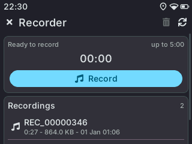
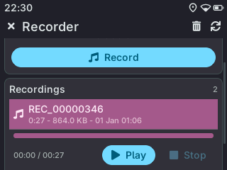
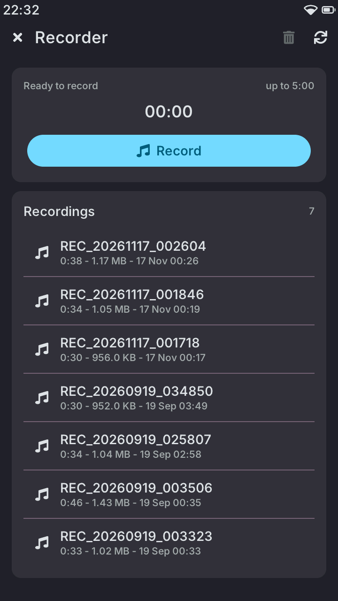
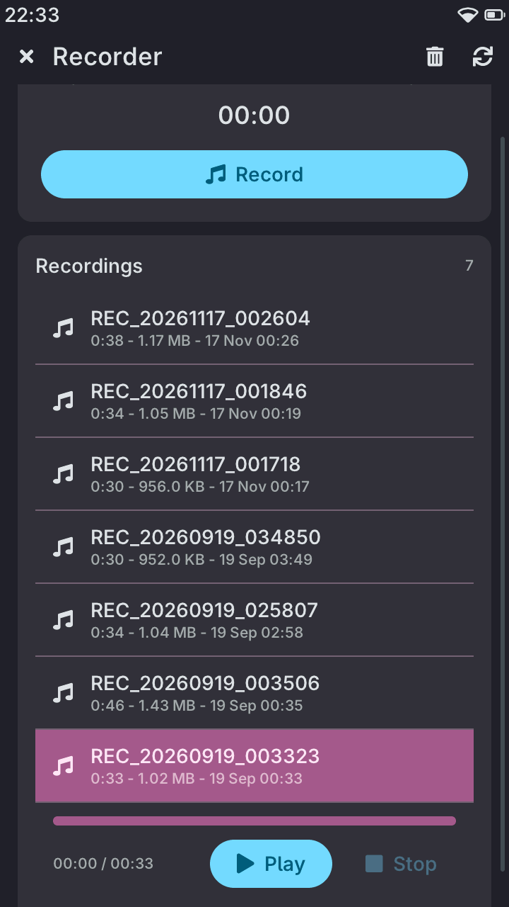

# Recorder

Records WAV audio from the device's microphone and plays the recordings back.

## Features

- Records 16 kHz, mono, 16-bit WAV files
- Recordings are listed newest-first with duration, size, and date
- Tap a recording to fold its player out directly beneath the row: progress bar, elapsed/total time, Play/Pause, and Stop
- The expanded player scrolls into view, also when the recording is at the bottom of a long list
- The file extension is hidden in the UI
- Material theme cards, buttons, list rows, and states, with no app-specific colors, shapes, or fixed sizes
- Responsive: one full-width column from small to large landscape displays
- Works with touch, keyboard, and trackball navigation

## Controls

- **Record / Stop and Save**: starts and stops recording. A new recording is selected automatically when it finishes.
- **Tap a recording**: expands its player below the row.
- **Play/Pause**: starts or pauses playback of the selected recording.
- **Stop**: stops playback.
- **Delete** (toolbar): deletes the selected recording after confirmation.
- **Refresh** (toolbar): rescans the recordings folder.
- **Close** (toolbar): exits the app.

## Screenshots

| Device | Recordings | Fold-out player |
| --- | --- | --- |
| T-Deck Plus (320x240) |  |  |
| Tab5 (720x1280) |  |  |

## Storage

Recordings are saved as `.wav` files in the app's user data directory. The toolbar delete button removes the selected file.

## Notes

- Recordings are limited to 5 minutes.
- Filenames and dates use the system clock. Set the time (RTC or NTP) for readable names and dates.
- The shown duration is derived from the file size for the recorder's 16 kHz, 16-bit mono format.
- Recording and playback require a device with an audio input and output.
