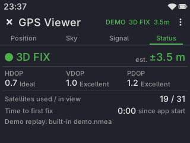
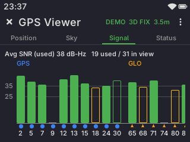
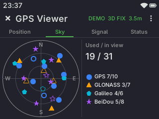
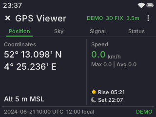
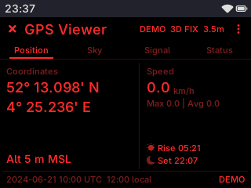

# GPS Viewer

A GNSS status app for [Tactility](https://github.com/TactilityProject/Tactility) devices, like the "GPS Test"
apps on Android. It shows the fix, the satellites in view and used, their signal strength and sky position,
and the position, speed and time. It is not a map.

Version 0.1.0, app id `tactility.gpsviewer`. Changes are listed in [CHANGELOG.md](CHANGELOG.md). Third-party
code is listed in [THIRD_PARTY.md](THIRD_PARTY.md).

## Install

Needs Tactility firmware with the GPS API exported to apps. For satellite systems the NMEA talker ID must also
be in `GpsEvent`. That change is the Tactility PR "gps: add NMEA talker ID to GpsEvent and export GPS API to
apps", not merged yet.

TODO: Tactility main after that PR, version to be filled in.

Without the talker ID the app still builds and runs. It then groups satellites by NMEA ID ranges only (see
[Known limits](#known-limits)).

1. Set up a GPS receiver in Tactility's GPS settings and turn on location.
2. Copy the `.app` file to the SD card, open it in the Files app and confirm "Install".
3. Start "GPS Viewer" from the app list.

The app subscribes to Tactility's location service, which starts the receiver, and reads the first started
GPS receiver. It never changes GPS settings. With no receiver it says so on the screen.

## Screen

Tactility's toolbar with the close button, the title, the fix state (for example `3D FIX  3.5m`, prefixed with
REC while recording, tap it for the Status tab) and the menu button. Below it four tabs: Position, Sky, Signal and Status.
The content is laid out flat, with thin dividers, in the colours of the Tactility theme (light or dark, and the
primary colour from Appearance). The monochrome theme drops the colours and keeps the marker shapes.

Colours per system: GPS blue, GLONASS orange, Galileo cyan, BeiDou purple. Night mode draws everything in
reds on black.

- **Position:** two tiles. Left: latitude and longitude in the chosen format (the font gets smaller when they do
  not fit), altitude and course over ground (only above 1 m/s). Right: speed, the maximum and average since
  start or the last reset, and sunrise and sunset for today at the position, computed offline with the NOAA
  algorithm. Below: UTC date and time from the RMC sentence, local time from Tactility's time zone, and REC
  while recording.
- **Sky:** polar plot, north up, rings at 0, 30 and 60 degrees elevation. The marker shape and colour show the
  system: circle GPS, triangle GLONASS, pentagon Galileo, star BeiDou, square QZSS and SBAS, diamond NavIC and
  unknown. A filled marker is used in the fix. The legend lists each system with used / in view counts, above
  it the total.
- **Signal:** one bar per satellite, height = signal strength (SNR, dB-Hz), grouped by system. Green from 35,
  orange from 25, grey below. A filled bar is used in the fix, an outlined bar is not. Under each bar are a
  system marker and the satellite ID. The average SNR of the used satellites is shown above. The bars scroll
  sideways when there are more than fit.
- **Status:** fix type, estimated accuracy, HDOP / VDOP / PDOP with a quality word, satellites used / in
  view, time to first fix and the receiver model. Accuracy is HDOP x 5 m. NMEA has no accuracy value, so the
  figure is labelled as an estimate. Time to first fix is counted from when the app started listening.

With no receiver, or with location turned off, a message says so, with an "Open settings" button that opens
Tactility's location settings.

## Controls

| To… | Keyboard | Trackball (keypad mode) | Trackball (pointer mode) | Touch |
| --- | --- | --- | --- | --- |
| Next / previous tab | Left / Right arrows, `.` / `,` or Space | Roll left / right | Click the tab name | Swipe left / right, or tap the tab name |
| Scroll the Signal bars | Left / Right (at the ends, Left / Right change the tab) | Roll left / right | Click and drag the bars | Drag the bars |
| Jump to a tab | `1`-`4` | — | Click the tab name | Tap the tab name |
| Open the action menu | Enter | Click | Click the ⋮ button | Tap the ⋮ button in the toolbar |
| Move in menus and settings | Up / Down or Left / Right | Roll | Click the row | Tap the row |
| Select in menus and settings | Enter | Click | Click the row | Tap the row |
| Close a menu or settings | Esc or Backspace | Select "< Back" | Click "< Back" | Tap "< Back" |
| Close the app | — | Select the X button | Click the X button | Tap the X button in the toolbar |

The keys `n` (night mode), `r` (reset max/average speed), `s` (settings) and `l` (start or stop recording)
work from the keyboard. `m` opens the menu. These actions are also in the menu.

Settings rows change their value on Enter or tap. The menu has: Reset max/average speed,
Start / Stop recording, Night mode on or off, Settings, Exit and "< Back".

## Settings

- **Units:** Metric (km/h, m), Imperial (mph, ft) or Nautical (kn, m). Nautical uses metres for altitude and
  accuracy.
- **Coordinates:** Degrees, Deg. minutes or Deg. min. seconds.
- **Night mode:** everything in red on black.

Settings are kept in `settings.txt` in the app's user data folder. The file is plain text with one `key=value`
per line.

## Recording

"Start recording" in the menu (or the `l` key) saves every NMEA sentence from the receiver to a file in
`logs/` in the app's user data folder. The file is named after the GPS date and time, `gps-YYYYMMDD-HHMMSS.nmea`,
or after the uptime, `gps-up<seconds>.nmea`, when the receiver has no time yet. The toolbar and the Position tab show
REC while recording. The file is written every 2 seconds, so a crash or power loss loses at most the last 2
seconds. Recording stops with "Stop recording" and when the app closes.

Sentences are written back from the parsed values: RMC, GGA, GSA and GSV with their checksums. Other
sentences and fields the app does not use are not saved. The logs are plain NMEA 0183, for use in other tools.

## Screenshots











## Testing

Tested on a LilyGO T-Deck with a Quectel L76K on the Grove port (GPS, GLONASS and BeiDou), outdoors and by a
window. Recording was tested on the device: the log of a live session has the same fix and satellites when
parsed again. The satellite database, NMEA writer, settings and formatting have host tests.

## Known limits

- Without the NMEA talker ID (see [Install](#install)), Galileo and BeiDou satellites are shown as GPS.
- NMEA has no accuracy value. The accuracy shown is HDOP x 5 m, an estimate only.
- Only tested on the LilyGO T-Deck, and with one receiver (L76K).
- Tactility starts the receiver when the app opens and stops it when the app closes. With "Auto-detect" in the
  GPS settings, the driver first tries other receiver types, which took about 4.4 s for the L76K. Choosing the
  model in the GPS settings skips that.
- Fonts are Tactility's three text sizes: there is no bold font.
- The "Open settings" message was not tested on the device: it needs a missing receiver or location turned off.

## Building

Needs ESP-IDF 6.1 and the Tactility SDK matching the firmware on the device. Set `TACTILITY_SDK_PATH` to the
SDK folder, then:

```
python <Tactility>/tt.py app build
python <Tactility>/tt.py app install --host <device ip>
python <Tactility>/tt.py app run --host <device ip>
```

## Licence

GPL-3.0-or-later, the same as Tactility; see [LICENSE](LICENSE). Third-party code is listed in
[THIRD_PARTY.md](THIRD_PARTY.md).
