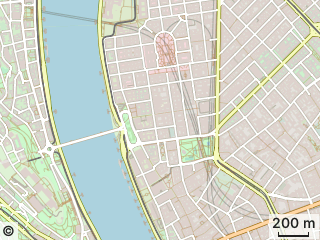
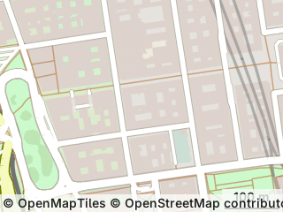
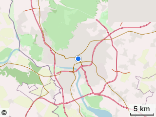
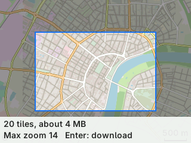
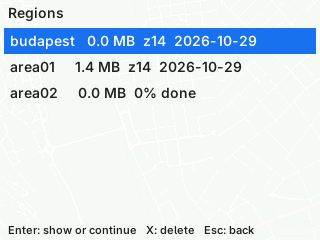
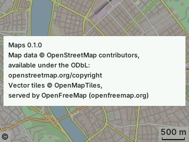

# Tactility Maps

Offline vector maps for [Tactility](https://github.com/TactilityProject/Tactility) devices. The device
downloads an area from [OpenFreeMap](https://openfreemap.org/) by itself and draws it fullscreen, with
anti-aliased roads, water, parks and buildings, from tiles on the SD card.

Version 0.0.1, a proof of concept, tested on a LilyGO T-Deck (ESP32-S3, 8 MB PSRAM). Changes are listed in
[CHANGELOG.md](CHANGELOG.md).

## Install

Needs Tactility 0.8.0 or newer on an ESP32-S3 board with PSRAM, a FAT-formatted SD card, and Wi-Fi for
downloading maps. Tested on Tactility 0.8.0-dev (main at 0e276da2) on a LilyGO T-Deck.

1. Install "Maps" from Tactility's App Hub. Or copy the `.app` file to the SD card, open it in the Files app and
   confirm "Install".
2. Start "Maps" from the app list. The first time it opens at ESA ESTEC in Noordwijk with no map data yet: move
   to your area, open the menu (M, long press or ☰) and choose Download area.

| Map at z14 | Overzoom z16 | Following the position |
|---|---|---|
|  |  |  |

| Download this area | Regions | About and licences |
|---|---|---|
|  |  |  |

Screenshots taken on the T-Deck. Map data © OpenMapTiles © OpenStreetMap contributors.

## How it works

- Vector tiles (OpenMapTiles schema) are stored one file per tile in `maps/<region>/<z>/<x>/<y>.pbf` on the SD card.
- The map stops LVGL and draws with Tactility's `pixel_buffer` API, like the built-in Terminal app.
- Tiles are inflated and decoded as a stream, never held whole in memory, and drawn with an exact-area
  anti-aliasing rasteriser. Two render tasks (one per core) fill a PSRAM cache. Rendered tiles can also be
  cached on the SD card (a setting, off by default).
- Zoom levels above 14 are drawn from the z14 vectors, so they stay sharp.
- Each downloaded tile also gets a prepared copy next to it (`<y>.prt`): only what the style draws, with
  quantised coordinates, grouped by draw order. It is about a fifth of the original's size and renders faster.
  The original `.pbf` is never changed; it keeps names and house numbers for later features.
- One task does all SD card reads and writes, tiles on screen first. Tiles around the screen are only
  prepared after a second without input, and any input cancels them.
- The position comes only from Tactility's location service. The app never changes location settings.
- Menus, lists and dialogs are drawn by the app as well, LVGL stays stopped while the app runs.

## Using the app

**Map screen.** The map fills the screen. Always visible: your position (●, with an accuracy
circle), the scale bar, and the © mark.

| To… | Keyboard | Trackball | Touch |
| --- | --- | --- | --- |
| Move the map | W A S D | Roll | Drag |
| Zoom in / out | I / O | — | Pinch, double tap to zoom in, or the + / − buttons |
| Show / hide controls | Space | Click on empty map | Tap the map |
| Centre on my position and follow | G | — | ⌖ button |
| Stop following | Move the map | Roll | Drag |
| Menu | M | Long click | ☰ button, or long press |
| Download this area | Shift + D | — | Menu → Download area |
| Credits | — | Click © | Tap ©, tap again for About and licences |
| Leave the app | Esc or Backspace | Menu → Exit | Menu → Exit |

**Controls.** Hidden by default. When shown: ☰ menu top left, + and − in the middle of the right edge, ⌖
position bottom right above the scale bar. With a keyboard each button shows its key. ⌖ is filled while
following, an outline when not, and crossed out when there is no position. With the trackball in mouse
mode a pointer appears while the controls show; roll to a button and click it, click on empty map to hide
them. On boards with buttons only (no keyboard, no touch), the buttons move the focus through the controls
and press the focused one.

**Menu:** Download area, Regions, Settings, About and licences, Exit. W/S, trackball or finger to
move; Enter, click or tap to choose; Esc, Backspace or tap outside to close.

**Downloading:** open Download area. The frame stays in the middle; move and zoom the map under
it. The bar shows tiles, size and max zoom, and updates live. Enter, click or Download starts it;
Esc cancels. It downloads in the background and resumes after a restart; areas share tiles.

**Regions:** list with size, date and status (complete, downloading, outdated). Select with W/S,
trackball or tap; delete with Del then confirm, or long press then Delete; Esc goes back.
Deleting keeps tiles another region still uses.

**Browsing:** with Wi-Fi, tiles on screen that have no detail on the card yet are downloaded while you
look at them (a small "Downloading map" label shows) and kept in the region "browsed", so they work
offline later. Without Wi-Fi a short message says that detail is missing here. Only the tiles on screen
are fetched, one at a time.

**Settings:** SD card cache on or off, prepared tiles deflated or raw, smooth pinch on or off, download
while browsing on or off. Defaults: SD card cache off (switched off, its files are deleted in idle time),
deflated, on, on. The map opens at ESA ESTEC, Noordwijk, the first time, then where you left it.

**Updates:** after about 30 s without input, outdated regions update quietly and a small
"Updating 42%" label shows. Any input pauses it. Only on Wi-Fi, and only when charging or above
a battery level. *(Planned for M4, not in this version yet.)*

**Position:** comes from Tactility's location service (GPS or approximate). If it's off, the ⌖
button is crossed out and pressing it says how to enable it in Tactility's settings.

## OpenFreeMap's rules

OpenFreeMap is free and needs no key. Its [terms of service](https://openfreemap.org/tos/) for offline downloads
are enforced in the app:
at most 3,000 tiles and 50 MB per download (the highest zoom level that fits is chosen, the download also
stops at 50 MB of real data), at most 4 parallel requests (the app uses 2), and a User-Agent that names the
app. The tile URL is read from OpenFreeMap's TileJSON. openstreetmap.org tile servers are never used.

## Known limits

- One download is at most 3,000 tiles or 50 MB (OpenFreeMap's terms). In dense cities that is only a few hundred
  z14 tiles, for example the centre of Budapest. Larger areas need several separate downloads, which you start
  yourself.
- No labels yet: no street, place or house names on the map.
- Touch, keyboard and trackball were tested on the LilyGO T-Deck only. Other boards, boards without PSRAM and
  monochrome or e-paper displays are untested.
- Regions don't update themselves yet (planned for M4). Delete a region and download it again for newer data.
- Monochrome (1-bit) displays: the map style loses most areas after Tactility's 1-bit conversion (planned for M4).
- The trackball in mouse mode is only lightly tested.

## Credits

- Map data: [OpenStreetMap](https://www.openstreetmap.org/copyright) contributors, available under the Open
  Database License (ODbL).
- Vector tile schema: [OpenMapTiles](https://openmaptiles.org/).
- Tiles served free of charge by [OpenFreeMap](https://openfreemap.org/), see its
  [terms](https://openfreemap.org/tos/).
- Built for [Tactility](https://github.com/TactilityProject/Tactility).

## Attribution

The full "© OpenMapTiles © OpenStreetMap contributors" shows for 5 seconds when the map opens and then
collapses to a small "©" mark in the bottom left corner. Tapping or clicking it shows the text again for 5
seconds, tapping the text opens "About and licences", which is also in the menu. This follows the OSMF
attribution guidelines for small screens.

## Building

Needs ESP-IDF 6.1 and the Tactility SDK matching the firmware on the device.

```
python <Tactility>/tt.py app build
python <Tactility>/tt.py app install --host <device ip>
python <Tactility>/tt.py app run --host <device ip>
```

The PC build (`host/`, CMake) renders tiles to PNG and runs the unit tests:

```
cmake -S host -B host/build
cmake --build host/build --config Release
host/build/Release/render_tile <folder with maps/> 47.4979 19.0402 14 640 480 out.png
host/build/Release/tests
host/build/Release/prepare_tiles <folder with maps/> [--write] [--deflate] [--zoom 16]
host/build/Release/ui_preview <output folder> [--mono]
```

`prepare_tiles` converts the tiles of a folder into prepared tiles and compares size, render time and pixels
with the originals (`--write` stores the `.prt` files, which `render_tile --prepared` then draws from).
`ui_preview` draws the app's screens over a fixture tile to PNG, with blocks in place of text.

`host/fetch_tiles.py` downloads a test area on the PC (same OpenFreeMap rules), `host/push_region.py`
copies it to a device through the development server.

Measurements on the T-Deck are in [docs/MEASUREMENTS.md](docs/MEASUREMENTS.md), the plan and its decisions in
[docs/PLAN.md](docs/PLAN.md).

## Licence

GPL-3.0-or-later, the same as Tactility; see [LICENSE](LICENSE). Third-party code and data are listed in [THIRD_PARTY.md](THIRD_PARTY.md). No code was copied from
the projects listed as prior art in the plan.
