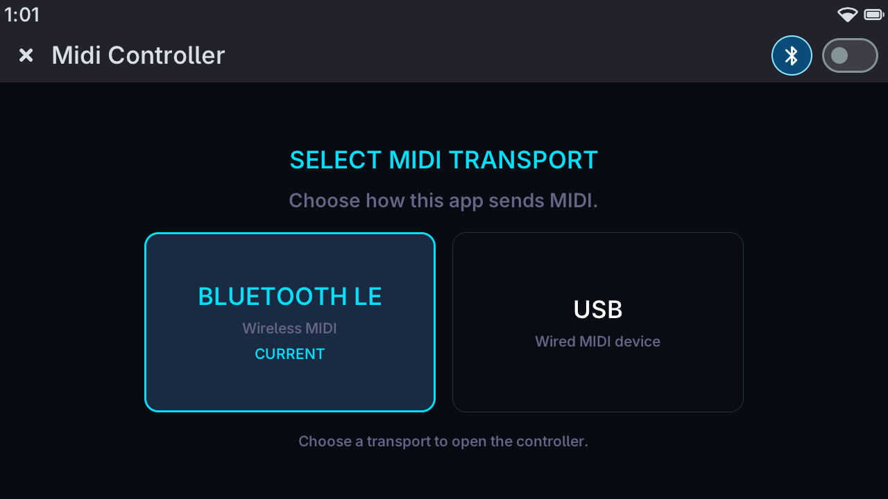
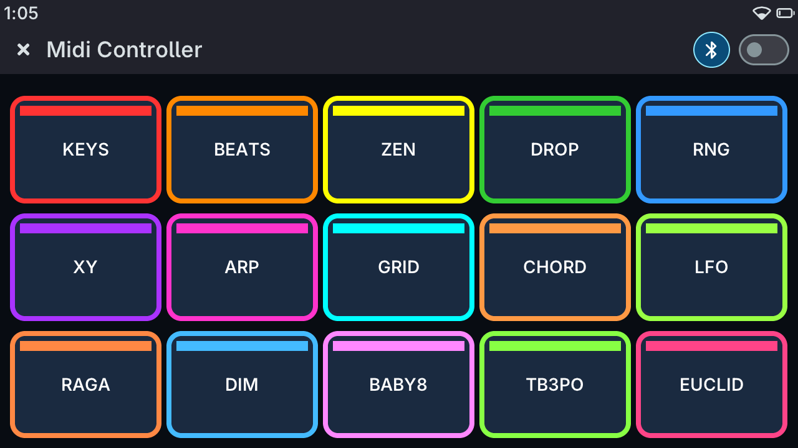

# MidiController - Documentation

MIDI controller app for the M5Stack Tab5 (ESP32-P4) built on the Tactility SDK.
Sends standard 3-byte MIDI over Bluetooth LE MIDI or USB MIDI to any DAW, synth, or hardware.

## Quick start

1. Pick **BLUETOOTH LE** or **USB** on the transport screen shown at launch (unless BLE MIDI is already running). You can change it later with the `USB`/`BLE` button in the toolbar while sending is stopped.
2. Flip the toolbar switch to start sending. For BLE, pair with your DAW/synth - the device advertises as **Tactility MIDI**.
3. Tap any mode tile on the home screen to begin.

Hardware accessories (8Encoder, LCD Unit) are optional - the app works without them.

## Bluetooth notes

The device advertises as `Tactility MIDI` with its own Bluetooth address and bond, so a host sees it
as a separate device from the other Tactility Bluetooth apps (Air Mouse, Media Keys). Pair it once
per host. Switching apps does not need a new pairing, the host reconnects each device on sight.

### Windows users

Windows users will need a BLE Midi Bridge of some sort after pairing to the pc.  
I can recommend either of these two, which have other needed information to set things up.  
https://github.com/Maxime-J/BLE-MIDI-Bridge  
https://github.com/mayerwin/Perfect-Bluetooth-MIDI-For-Windows

### Linux users

Linux - BlueZ may need recompilation depending on distro. Possibly helpful info https://linuxmusicians.com/viewtopic.php?t=24481

### MAC users
MAC - Bluetooth midi should be supported by default i believe.

## USB Notes

Nothing, USB Midi should just be plug n play. Select the `Tactility MIDI` device in your DAW/Synth etc

## Contents

| File | What it covers |
|------|---------------|
| [hardware.md](docs/hardware.md) | Tab5 device, Port A wiring, I2C units, PaHub channel map |
| [architecture.md](docs/architecture.md) | Code layout, mode lifecycle, LVGL patterns, BLE/USB MIDI plumbing |
| [modes.md](docs/modes.md) | All 15 modes - parameters, controls, musical function |
| [encoder.md](docs/encoder.md) | 8Encoder knob/button/LED assignments per mode |
| [lcd.md](docs/lcd.md) | LCD Unit display layouts per mode |
| [scales.md](docs/scales.md) | Scale and key system, MIDI note helpers |
| [units.md](docs/units.md) | Unit drivers in `Libraries/M5UnitModules` (8Encoder, PaHub, LCD, ByteButton, Joystick2, Scroll) |

## Screenshots (more screenshots in the images folder)

 
